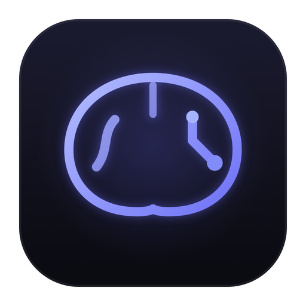

<p align="center">
  
</p>

<h1 align="center">Cerebro</h1>

<p align="center">
  A fast, local-first personal knowledge base: write Markdown, link with
  <code>[[wikilinks]]</code>, search everything, and let notes that share tags
  or title words surface connections you might have missed.
</p>

<p align="center">
  <a href="https://github.com/ebarczynski/cerebro/actions/workflows/ci.yml"></a>
  <a href="https://github.com/ebarczynski/cerebro/actions/workflows/release.yml"></a>
  <a href="https://github.com/ebarczynski/cerebro/releases/latest"></a>
  <a href="https://github.com/ebarczynski/cerebro/releases"></a>
  <a href="LICENSE"></a>
  <a href="https://www.rust-lang.org"></a>
</p>

---

## Features

- **Markdown-native** — `.md` files are the source of truth. The SQLite
  database is an index that can be rebuilt from them at any time
  (`cerebro reindex`; the GUI does it on every open). See
  [What lives only in the database](#what-lives-only-in-the-database).
- **Obsidian vault import (GUI)** — brings the Markdown notes of an existing
  vault into Cerebro, keeping the folder structure, YAML frontmatter tags,
  inline `#tags` and `[[wikilinks]]`. `.obsidian/`, `.trash/` and other hidden
  directories are skipped, and so is a note that already exists at the
  destination path (re-running an import never duplicates anything). Up to
  5,000 files per import. Attachments (images, PDFs) are **not** copied.
- **Document import** — PDF, DOCX, PPTX, XLSX, XLS, ODS, ODT, HTML, Markdown,
  JSON and plain-text/source files (52 extensions, including `.rs`, `.py`,
  `.ts`, `.go`) each become one Markdown note. Extraction is done by Rust
  libraries; the single exception is legacy `.doc`, which needs
  [LibreOffice](https://www.libreoffice.org). Every worksheet of a
  spreadsheet is imported. PDFs yield their text layer only — there is no OCR.
- **Dual-profile vaults** — each vault is its own directory with its own
  notes and its own database (`personal` and `professional` exist by default;
  `cerebro profile create <name>` adds more).
- **Wikilinks** — `[[Note Name]]`, with `[[Note#heading]]` and `[[Note|alias]]`.
  Targets are resolved the way Obsidian does: by `title:` frontmatter, then
  by exact path, then by file name (case-insensitive).
- **Bidirectional links** — backlinks and forward links are tracked in the index.
- **Full-text search** — SQLite FTS5 with the Porter stemmer over note titles,
  bodies and tags.
- **Tag management** — frontmatter `tags:` and inline `#tags`, normalized to
  lower case.
- **Daily notes** — `cerebro daily [date]` in the CLI, the daily-note button
  in the GUI.
- **Knowledge graph** — interactive D3.js force-directed graph of your
  wikilinks, plus *auto-links* between notes that share tags or title words
  (at most 20 per note — see [How auto-links work](#how-auto-links-work)).
- **Keyboard shortcuts help** — press `?` (or the **?** toolbar button) anytime
- **Knowledge Palace connector** — semantic/hybrid/keyword search through a
  Knowledge Palace server, from the CLI and from MCP. When KP is disabled or
  cannot be reached, local full-text results are returned instead, labelled
  as such.
- **Git sync** — manual version control of a vault's notes directory through
  the `git` command-line tool (`cerebro sync status|push|pull`). Nothing is
  committed or pushed automatically.
- **MCP server** — JSON-RPC 2.0 over stdio for Copilot, Hermes, and other MCP
  clients.
- **Tauri 2 GUI** — native desktop app (macOS + Linux), dark theme, split-pane
  layout. The sidebar lists the 500 most recently changed notes; search and
  the graph cover the whole vault.
- **CLI** — full command-line interface for scripting and automation.
- **Not implemented: encryption at rest.** Setting `encryption = true` in a
  vault's configuration is refused with an error rather than silently storing
  plaintext.

## Installation

Prebuilt binaries from [Releases](https://github.com/ebarczynski/cerebro/releases/latest):

| Platform | Get it | Requirements |
|---|---|---|
| 🍎 macOS (Apple Silicon) | `Cerebro_<ver>_aarch64.dmg` — drag to `/Applications` | macOS 26 (Tahoe) or newer |
| 🐧 Linux (x86_64) | `Cerebro_<ver>_amd64.deb` — `sudo dpkg -i` | WebKitGTK 4.1 (pulled in via apt) |
| CLI (both platforms) | `cerebro-<ver>-<platform>.tar.gz` | any; ships with `.sha256` checksums |

> The macOS build is ad-hoc signed (no paid Apple certificate), so Gatekeeper
> shows one warning on first launch: right-click → **Open**, or run
> `xattr -cr /Applications/Cerebro.app`.

Or build from source — see [Quick Start](#quick-start).

## Architecture

```
cerebro/
├── src/                          # Core library (cerebro crate)
│   ├── config/                   # TOML config, profiles, which profile a command acts on
│   ├── storage/                  # SQLite CRUD, FTS5, migrations, link resolution, reindex
│   ├── parser/                   # Frontmatter, wikilinks and tag extraction (regex)
│   ├── import/                   # PDF/PPTX/DOCX/XLSX/XLS/ODS/ODT/HTML/text → Markdown
│   ├── links/                    # petgraph LinkGraph (library type; the app serves graphs from SQLite)
│   ├── search/                   # Thin wrapper over the FTS5 query
│   ├── mcp/                      # MCP server (JSON-RPC 2.0 over stdio)
│   ├── kp/                       # Knowledge Palace HTTP connector
│   ├── sync/                     # Git sync through the `git` CLI
│   └── cli/                      # clap CLI interface
├── crates/gui/                   # Tauri 2 GUI application
│   ├── src/main.rs               # 40 Tauri commands wired to the core lib
│   ├── icons/icon.svg            # Logo design source (brain-circuit mark)
│   ├── frontend/                 # React 19 + TypeScript frontend
│   │   ├── src/
│   │   │   ├── App.tsx           # Main app with graph view, preview, welcome
│   │   │   └── components/       # Sidebar, Editor, Search, StatusBar, Logo,
│   │   │                         # ImportDropZone, ImportObsidianModal, ShortcutsModal
│   │   └── index.css             # TailwindCSS v4 dark theme
│   └── tauri.conf.json           # Tauri configuration
├── migrations/                   # SQLite schema migrations
├── benches/vault_bench.rs        # Vault-scale benchmark
└── tests/                        # Integration tests (plus unit tests in each crate)
```

The `cerebro` package is both a library and the `cerebro` CLI binary;
`cerebro-gui` is a second binary that links the same library.

## Quick Start

### CLI

```bash
# Build release
cargo build --release

# Initialize a vault
cerebro init

# Create a note
cerebro notes create "My First Note" -c "# Hello World\n\nThis is my first note."

# Search
cerebro search "hello world"

# Show backlinks
cerebro backlinks "My First Note"

# Start MCP server (for Copilot/Hermes)
cerebro mcp
```

If you add or edit `.md` files outside Cerebro, run `cerebro reindex` to bring
the search index up to date.

### GUI from source

```bash
# Prerequisites (Linux)
sudo apt-get install -y pkg-config libwebkit2gtk-4.1-dev libgtk-3-dev \
  libayatana-appindicator3-dev librsvg2-dev libsoup-3.0-dev \
  libjavascriptcoregtk-4.1-dev

# Install frontend deps
cd crates/gui/frontend && npm install && cd ../../..

# Run in dev mode
cargo tauri dev

# Build release bundle
cargo tauri build
```

### Importing from Obsidian

Bring the Markdown notes of an existing Obsidian vault into Cerebro:

1. Open a vault in the GUI (create a fresh one if you like)
2. Click the **💠 gem** button in the toolbar — or press `Ctrl+Shift+O` (`⌘⇧O` on macOS)
3. Pick your Obsidian vault folder, choose a destination folder (default: `Obsidian/`), and hit **Import Vault**

What's preserved:

| Obsidian artifact | Cerebro result |
|---|---|
| Folder structure | Mirrored under the destination folder |
| Note names | Titles (Obsidian convention: filename without extension) |
| YAML frontmatter `tags:` | Merged into the note's tags |
| Inline `#tags` | Merged into the note's tags |
| `[[wikilinks]]` | Kept as-is and resolved by file name |
| `.obsidian/`, `.trash/`, hidden dirs | Skipped |

Notes that already exist at the destination path are skipped, so re-running an
import never duplicates anything. Attachments are not copied, and an import
stops at 5,000 files.

### Keyboard shortcuts

Press `?` anywhere outside a text field (or click the **?** toolbar button) for
the always-available cheat sheet. Highlights:

| Keys | Action |
|---|---|
| `Ctrl+K` | Search notes |
| `Ctrl+N` | New note |
| `Ctrl+S` | Save note |
| `Ctrl+E` | Cycle view: edit → split → preview |
| `Ctrl+P` | Toggle preview |
| `Ctrl+G` | Knowledge graph |
| `Ctrl+Shift+O` | Import Obsidian vault |
| `Ctrl+F` / `Ctrl+H` | Find / find & replace in note |
| `Ctrl+=` / `Ctrl−` / `Ctrl+0` | Editor font size up / down / reset |

(Use `⌘` instead of `Ctrl` on macOS.)

### MCP Tools (for AI coding tools)

The MCP server exposes 10 tools over stdio:

| Tool | Description |
|------|-------------|
| `cerebro_search` | Full-text search across all notes |
| `cerebro_read_note` | Read a note by title or path |
| `cerebro_create_note` | Create a new note with optional tags (never overwrites an existing note) |
| `cerebro_update_note` | Update an existing note's content |
| `cerebro_delete_note` | Permanently delete a note — its file and its index entries; cannot be undone |
| `cerebro_list_notes` | List notes, optionally filtered by tag |
| `cerebro_list_tags` | List all tags with counts |
| `cerebro_backlinks` | Get notes linking to a given note |
| `cerebro_graph` | Get the full knowledge graph (nodes + edges) |
| `cerebro_kp_search` | Semantic/hybrid/keyword search via Knowledge Palace — falls back to local FTS when KP is down, explicitly labelled (`"source": "local_fts"`) |

Every tool takes an optional `profile` argument (it must already exist);
without one the active profile is used — or the one given as
`cerebro --profile <name> mcp`.

> The server answers `ping`, accepts single requests and JSON-RPC batches, and
> negotiates protocol versions 2024-11-05, 2025-03-26 and 2025-06-18. Unknown
> tools and invalid arguments are JSON-RPC errors (`-32602`); tool failures set
> `isError: true`. Only JSON-RPC ever goes to stdout — logs go to stderr.
>
> While a `cerebro_kp_search` call is waiting on Knowledge Palace (up to 10 s),
> no other request is answered: the server handles one request at a time.

## Configuration

Cerebro has two configuration files.

```toml
# ~/.cerebro/config.toml — global settings
default_profile = "personal"
editor = "vim"                 # used by `cerebro notes edit` and `cerebro daily`
# profiles_dir = "/home/you/.cerebro/profiles"   # default: ~/.cerebro/profiles
# active_profile = "work"                        # set by `cerebro profile switch`

[knowledge_palace]             # used by `cerebro kp` and the MCP tool
enabled = false
endpoint = "http://localhost:8080"
sync_scope = "all"
```

Each vault has its own file next to its database and notes:

```toml
# ~/.cerebro/profiles/<name>/vault.toml — one per vault
name = "personal"
display_name = "Personal"
notes_dir = "notes"             # relative to the profile directory, or absolute
encryption = false              # must stay false: `true` is refused (not implemented)
kind = "private"                # "private" | "business" — a label the GUI colour-codes

[knowledge_palace]             # read by the GUI's kp_search / kp_health commands
enabled = false
endpoint = "http://localhost:8080"
sync_scope = "all"

[sync]
method = "none"                 # "git" enables `cerebro sync`
remote = ""                     # e.g. "git@github.com:you/notes.git"
branch = "main"
```

## Development

```bash
# Run all tests (library, CLI/MCP, GUI). A bare `cargo test` covers the
# `cerebro` package only.
cargo test --workspace

# Lint — this must pass with no warnings
cargo clippy --workspace --all-targets -- -D warnings

# Vault-scale benchmark (cold/warm reindex, FTS5 latency, auto-links, graph)
CEREBRO_BENCH=1 cargo run --release --bench vault_bench -- --sizes 1000,5000,10000

# Build core library only
cargo build --release -p cerebro

# Build GUI only
cargo build --release -p cerebro-gui

# Frontend development
cd crates/gui/frontend
npm run dev

# Regenerate app icons after editing the logo source
cd crates/gui
frontend/node_modules/.bin/tauri icon icons/icon.png
```

## Benchmarks

## Benchmarks

Measured for the 2026-11-23 audit on an Apple M5 Pro (18 cores, 69 GB RAM,
macOS), release build (`lto = true`, `codegen-units = 1`). The vaults are
synthetic — notes of roughly 400 words with 2–4 tags and 3–8 wikilinks each —
generated with a fixed seed by `benches/vault_bench.rs`, so both builds were
measured on byte-identical input. *Before* is `master` at `ad51bfa`, *after* is
the audited code. **Cold** = index built from an empty database; **warm** = a
second run over unchanged files, which is what the GUI does every time a vault
is opened. Latencies are exact percentiles of 200 individual queries per class,
in-process, limit 10.

| | 1,000 notes | 5,000 notes | 10,000 notes |
|---|---|---|---|
| Markdown on disk | 4.3 MB | 21.3 MB | 42.7 MB |
| Index size on disk | 14.8 MB | 60.1 MB | 120.0 MB |
| Reindex, cold — before → after | 0.81 s → **0.21 s** | 7.24 s → **1.27 s** | 24.48 s → **2.75 s** |
| Reindex, warm — before → after | 0.92 s → **0.07 s** | 7.91 s → **0.38 s** | 30.19 s → **0.96 s** |
| Wikilinks resolved after a cold reindex | 45 % → **89 %** | 45 % → **90 %** | 45 % → **90 %** |
| FTS5 search, worst p50 of 7 query classes | 0.69 ms | 2.41 ms | 4.57 ms |
| FTS5 search, worst p99 of 7 query classes | 1.04 ms | 3.31 ms | 6.18 ms |
| Auto-links: time / links emitted / JSON for the GUI | 0.03 s / 12,427 / 1.6 MB <br>(was 0.11 s / 70,366 / 9.1 MB) | 0.65 s / 63,634 / 8.4 MB <br>(was 2.78 s / 1,748,722 / 222.4 MB) | 2.50 s / 127,547 / 16.7 MB <br>(was 11.07 s / 6,964,861 / 894.5 MB) |
| Graph for the GUI — before → after | 43 ms → **6 ms** | 810 ms → **34 ms** | 5,871 ms → **68 ms** |
| Peak RSS of the benchmark process — before → after | 54 → **30 MB** | 424 → **100 MB** | 1,414 → **180 MB** |

The links still unresolved after a cold reindex point at notes that
deliberately do not exist in these vaults (about one in ten).

The seven FTS5 query classes are a single common word, a single rare word, two
words joined by `AND`, a phrase, a prefix query, an exact title and a term that
matches nothing.

Whole processes, measured with `/usr/bin/time -l` on the final build:

| | 1,000 notes | 5,000 notes | 10,000 notes |
|---|---|---|---|
| `cerebro reindex`, cold, including process start | 0.30 s | 1.64 s | 3.67 s |
| `cerebro reindex`, warm | 0.07 s | 0.40 s | 0.90 s |
| CLI peak RSS | 17.6 MB | 19.9 MB | 23.3 MB |
| MCP server peak RSS, 50-call session | 31 MB | 107 MB | 204 MB |
| MCP `cerebro_search` p50 / p99 | 1.16 / 1.59 ms | 2.88 / 3.30 ms | 5.12 / 5.59 ms |
| MCP `cerebro_graph` p50 / p99 | 6.3 / 7.6 ms | 31.4 / 38.6 ms | 63.2 / 75.5 ms |
| MCP `cerebro_create_note` p50 | 1.15 ms | 1.16 ms | 1.00 ms |

Read these with the usual caveats. The index grew by 7–20 %: link contexts now
hold the correct line, and three lookup indexes were added. Auto-linking
compares every pair of notes, so its time grows with the square of the note
count — it runs off the GUI's main thread, and its output is capped at 20 links
per note. And synthetic vaults are not your vault: long paragraphs, many tags
per note or large attachments will move these numbers.

Reproduce with:

```bash
CEREBRO_BENCH=1 cargo run --release --bench vault_bench -- --sizes 1000,5000,10000
```

## Tech Stack

| Component | Technology |
|-----------|------------|
| Core library | Rust 1.96, edition 2024 |
| Storage | SQLite 3.49 (bundled) + FTS5, WAL mode |
| Parser | Hand-written frontmatter, wikilink and tag extraction (`regex`) |
| Graph | Served from the SQLite `links` table; `petgraph` backs the library's `LinkGraph` type |
| GUI framework | Tauri 2 |
| Frontend | React 19 + TypeScript, Markdown rendered with `marked` |
| Editor | CodeMirror 6 |
| Styling | TailwindCSS v4 |
| Graph viz | D3.js force-directed |
| CLI | clap 4 |
| HTTP client | reqwest (KP connector) |
| MCP | JSON-RPC 2.0 over stdio |
| Git sync | the `git` command-line tool (no git library linked) |
| Build | cargo + Vite |

## Known limitations

Things Cerebro does **not** do (yet), so you can decide whether they matter to you:

- **No encryption at rest.** Notes and the database are plaintext files in
  your vault directory. `encryption = true` is refused.
- **The GUI sidebar shows at most 500 notes** — the most recently changed
  ones. Full-text search, the graph, the CLI and MCP cover the whole vault.
- **A vault's metadata is not in the `.md` files.** See below.
- **Git sync is manual and conflict-agnostic.** A pull that conflicts fails
  with git's message and leaves the vault as git leaves it (conflict markers,
  `MERGE_HEAD`). Resolve it with git, then `cerebro reindex`. The GUI has no
  sync controls.
- **The Knowledge Palace endpoint is global** for the CLI and MCP (one
  `[knowledge_palace]` in `config.toml` for all profiles); the per-vault
  section in `vault.toml` is only read by the GUI's KP commands.
- **Auto-links look at tags and titles, not note bodies.**
- **No OCR for PDFs, no LibreOffice-free `.doc` import.**
- **Markdown preview renders raw HTML** in notes (scripts are blocked by the
  CSP; images may be loaded from remote hosts).
- **Plain-text notes only.** A note file must be valid UTF-8; other files are
  skipped during indexing.

### What lives only in the database

The `.md` files are the source of truth for *content*, tags and wikilinks, but
a few things exist only in `db.sqlite`:

| Stored only in the database | Lost when the database is rebuilt |
|---|---|
| Favorites and categories | yes |
| `created_at` / `updated_at` | reset to the time of the rebuild |
| Note IDs (UUIDs) | regenerated — anything holding an old ID must look notes up again |

The index is rebuilt automatically when it is missing: the GUI reindexes every
time a vault is opened, and a CLI or MCP command rebuilds an empty index from
the `.md` files before it runs.

### How auto-links work

For every pair of notes Cerebro computes a Jaccard similarity of their tag sets
and of their title words, and links the pair when
`0.7 × tag_similarity + 0.3 × title_similarity ≥ 0.15` and they share at least
one tag (or more than half their title words). The result is quadratic in the
number of notes and can be huge in dense tag clusters, so at most
`MAX_KEYWORD_LINKS_PER_NOTE` (20) auto-links are kept per note — its
highest-scoring ones.

## License

[MIT](LICENSE) — see [LICENSE](LICENSE).
