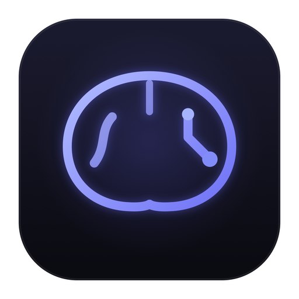

<p align="center">
  
</p>

<h1 align="center">Cerebro</h1>

<p align="center">
  A fast, local-first personal knowledge base that grows the graph for you:
  write Markdown, link with <code>[[wikilinks]]</code>, and let keyword analysis
  surface the connections you didn't notice.
</p>

<p align="center">
  <a href="https://github.com/ebarczynski/cerebro/actions/workflows/ci.yml"></a>
  <a href="https://github.com/ebarczynski/cerebro/actions/workflows/release.yml"></a>
  <a href="https://github.com/ebarczynski/cerebro/releases/latest"></a>
  <a href="https://github.com/ebarczynski/cerebro/releases"></a>
  <a href="LICENSE"></a>
  <a href="https://www.rust-lang.org"></a>
</p>

---

## Features

- **Markdown-native** — `.md` files are the source of truth, with YAML frontmatter
- **Obsidian vault import** — import an entire Obsidian vault in one step:
  folder structure, YAML frontmatter tags, inline `#tags` and `[[wikilinks]]`
  are all preserved (`.obsidian` config is skipped, duplicates detected)
- **Document import** — drag & drop PDF, DOCX, PPTX, XLSX/ODS, HTML, Markdown,
  JSON or source files; each converts to a Markdown note
- **Dual-profile vaults** — separate personal and professional knowledge domains
- **Wikilinks** — `[[Note Name]]` with `#heading` and `|alias` support
- **Bidirectional links** — automatic backlink and forward-link tracking
- **Full-text search** — SQLite FTS5 with Porter stemmer
- **Tag management** — unified frontmatter `tags:` + inline `#tags`
- **Daily notes** — `/Daily/YYYY-MM-DD.md` auto-generated
- **Knowledge graph** — interactive D3.js force-directed graph visualization,
  with automatic keyword-based links between notes
- **Keyboard shortcuts help** — press `?` (or the **?** toolbar button) anytime
- **Knowledge Palace connector** — semantic/RAG search via pgvector at `localhost:8080`
- **Git sync** — automatic version control for vaults
- **MCP server** — JSON-RPC 2.0 over stdio for Copilot, Hermes, and other MCP clients
- **Tauri 2.0 GUI** — native desktop app (macOS + Linux), dark theme, split-pane layout
- **CLI** — full command-line interface for scripting and automation
- **Encryption (optional, per vault)** — AES-256-GCM notes + SQLCipher
  database, Argon2id passphrase; Business vaults protected by default,
  Personal/Project opt-in (ADR 0006)

## Installation

Prebuilt binaries from [Releases](https://github.com/ebarczynski/cerebro/releases/latest):

| Platform | Get it | Requirements |
|---|---|---|
| 🍎 macOS (Apple Silicon) | `Cerebro_<ver>_aarch64.dmg` — drag to `/Applications` | macOS 26 (Tahoe) or newer |
| 🐧 Linux (x86_64) | `Cerebro_<ver>_amd64.deb` — `sudo dpkg -i` | WebKitGTK 4.1 (pulled in via apt) |
| CLI (both platforms) | `cerebro-<ver>-<platform>.tar.gz` | any; ships with `.sha256` checksums |

> The macOS build is ad-hoc signed (no paid Apple certificate), so Gatekeeper
> shows one warning on first launch: right-click → **Open**, or run
> `xattr -cr /Applications/Cerebro.app`.

Or build from source — see [Quick Start](#quick-start).

## Architecture

```
cerebro/
├── src/                          # Core library (cerebro crate)
│   ├── config/                   # TOML config, profile management
│   ├── storage/                  # SQLite CRUD, FTS5, migrations
│   ├── parser/                   # Markdown parsing, frontmatter, wikilinks
│   ├── import/                   # PDF/PPTX/DOCX/XLSX/ODT/HTML → Markdown
│   ├── links/                    # petgraph bidirectional link graph
│   ├── search/                   # SQLite FTS5 full-text search wrapper
│   ├── mcp/                      # MCP server (JSON-RPC 2.0 over stdio)
│   ├── kp/                       # Knowledge Palace HTTP connector
│   ├── sync/                     # Git-based sync
│   └── cli/                      # clap CLI interface
├── crates/gui/                   # Tauri 2.0 GUI application
│   ├── src/main.rs               # 40 Tauri commands wired to core lib
│   ├── icons/icon.svg            # Logo design source (brain-circuit mark)
│   ├── frontend/                 # React 19 + TypeScript frontend
│   │   ├── src/
│   │   │   ├── App.tsx           # Main app with graph view, preview, welcome
│   │   │   └── components/       # Sidebar, Editor, Search, StatusBar, Logo,
│   │   │                         # ImportDropZone, ImportObsidianModal, ShortcutsModal
│   │   └── index.css             # TailwindCSS v4 dark theme
│   └── tauri.conf.json           # Tauri configuration
├── migrations/                   # SQLite schema migrations
└── tests/                        # Integration tests (plus unit tests in each crate)
```

## Quick Start

### CLI

```bash
# Build release
cargo build --release

# Initialize a vault
cerebro init

# Create a note
cerebro notes create "My First Note" -c "# Hello World\n\nThis is my first note."

# Search
cerebro search "hello world"

# Show backlinks
cerebro backlinks "My First Note"

# Start MCP server (for Copilot/Hermes)
cerebro mcp
```

### GUI from source

```bash
# Prerequisites (Linux)
sudo apt-get install -y pkg-config libwebkit2gtk-4.1-dev libgtk-3-dev \
  libayatana-appindicator3-dev librsvg2-dev libsoup-3.0-dev \
  libjavascriptcoregtk-4.1-dev

# Install frontend deps
cd crates/gui/frontend && npm install && cd ../../..

# Run in dev mode
cargo tauri dev

# Build release bundle
cargo tauri build
```

### Importing from Obsidian

Bring an existing Obsidian vault into Cerebro without losing anything:

1. Open a vault in the GUI (create a fresh one if you like)
2. Click the **💠 gem** button in the toolbar — or press `Ctrl+Shift+O` (`⌘⇧O` on macOS)
3. Pick your Obsidian vault folder, choose a destination folder (default: `Obsidian/`), and hit **Import Vault**

What's preserved:

| Obsidian artifact | Cerebro result |
|---|---|
| Folder structure | Mirrored under the destination folder |
| Note names | Titles (Obsidian convention: filename without extension) |
| YAML frontmatter `tags:` | Merged into the note's tags |
| Inline `#tags` | Merged into the note's tags |
| `[[wikilinks]]` | Kept as-is and resolved against imported titles |
| `.obsidian/`, `.trash/`, hidden dirs | Skipped |

Notes that already exist at the destination path are skipped, so re-running an
import never duplicates anything.

### Keyboard shortcuts

Press `?` anywhere outside a text field (or click the **?** toolbar button) for
the always-available cheat sheet. Highlights:

| Keys | Action |
|---|---|
| `Ctrl+K` | Search notes |
| `Ctrl+N` | New note |
| `Ctrl+S` | Save note |
| `Ctrl+E` | Cycle view: edit → split → preview |
| `Ctrl+P` | Toggle preview |
| `Ctrl+G` | Knowledge graph |
| `Ctrl+Shift+O` | Import Obsidian vault |
| `Ctrl+F` / `Ctrl+H` | Find / find & replace in note |
| `Ctrl+=` / `Ctrl−` / `Ctrl+0` | Editor font size up / down / reset |

(Use `⌘` instead of `Ctrl` on macOS.)

### MCP Tools (for AI coding tools)

The MCP server exposes 10 tools over stdio:

| Tool | Description |
|------|-------------|
| `cerebro_search` | Full-text search across all notes |
| `cerebro_read_note` | Read a note by title or path |
| `cerebro_create_note` | Create a new note with optional tags |
| `cerebro_update_note` | Update an existing note's content |
| `cerebro_delete_note` | Delete a note |
| `cerebro_list_notes` | List notes, optionally filtered by tag |
| `cerebro_list_tags` | List all tags with counts |
| `cerebro_backlinks` | Get notes linking to a given note |
| `cerebro_graph` | Get the full knowledge graph (nodes + edges) |
| `cerebro_kp_search` | Semantic/hybrid/keyword search via Knowledge Palace — falls back to local FTS when KP is down, explicitly labeled |

> Unknown tools return a JSON-RPC error; tool failures set `isError: true`;
> the server negotiates protocol versions 2024-11-05 through 2025-06-18.

## Security

Vaults are plaintext unless you protect them (ADR 0006). Protection is
per-vault and encrypts everything at rest: every `.md` note (AES-256-GCM)
and the database (SQLCipher). The master key is wrapped with Argon2id over
your passphrase — **there is no recovery code and no reset**: losing the
passphrase means losing the vault's contents.

```bash
cerebro vault encrypt work        # warns, asks passphrase twice
cerebro vault status work         # protection status
cerebro vault decrypt work        # removes protection (needs passphrase)
```

- Business vaults: protection recommended — enable right after creation with
  `cerebro vault encrypt <name>` (a create-time prompt is a planned follow-up).
- Personal/Project vaults: plaintext by default — encryption never gets in
  your way unless you turn it on.
- Unlock lasts for the session; relock happens on system sleep or manually
  (`Ctrl/Cmd+L` in the GUI). No idle relock.
- macOS: `--keychain` optionally caches the unlock key behind your user
  session for convenience. The passphrase remains the only credential.

### MCP sandbox

AI clients get what you declare, nothing more (ADR 0007):

```toml
[mcp.profiles.work]
allow = "read"          # none | read | write
deny_tools = ["cerebro_delete_note"]

[mcp.profiles.personal]
allow = "none"          # invisible over MCP
```

- Default: active profile read-only, everything else `none`.
- `cerebro mcp --scope work:write` overrides for one session.
- Protected vaults are invisible to MCP unless unlocked at server start
  (`cerebro mcp --unlock work`).
- Every call is audited to `~/.cerebro/audit/mcp.jsonl` (timestamp, tool,
  profile, decision — never note content).

### Contexts

Vault kinds: `private` (personal), `business` (work), `project` — one vault
per context, isolated at the storage level with independent keys and
policies (ADR 0008).

## Configuration

Cerebro stores config at `~/.cerebro/config.toml`:

```toml
[app]
default_profile = "personal"

[profiles.personal]
display_name = "Personal"
notes_dir = "notes"
encryption = false

[profiles.personal.knowledge_palace]
enabled = true
endpoint = "http://localhost:8080"

[profiles.professional]
display_name = "Professional"
notes_dir = "notes"
encryption = false
```

## Development

```bash
# Run all tests
cargo test

# Lint
cargo clippy -- -D warnings

# Build core library only
cargo build --release -p cerebro

# Build GUI only
cargo build --release -p cerebro-gui

# Frontend development
cd crates/gui/frontend
npm run dev

# Regenerate app icons after editing the logo source
cd crates/gui
frontend/node_modules/.bin/tauri icon icons/icon.png
```

## Tech Stack

| Component | Technology |
|-----------|------------|
| Core library | Rust 1.96.0, edition 2024 |
| Storage | SQLite + FTS5 |
| Parser | pulldown-cmark |
| Link graph | petgraph |
| GUI framework | Tauri 2.0 |
| Frontend | React 19 + TypeScript |
| Editor | CodeMirror 6 |
| Styling | TailwindCSS v4 |
| Graph viz | D3.js force-directed |
| CLI | clap 4 |
| HTTP client | reqwest (KP connector) |
| MCP | JSON-RPC 2.0 over stdio |
| Build | cargo + Vite |

## License

[MIT](LICENSE) — see [LICENSE](LICENSE).
